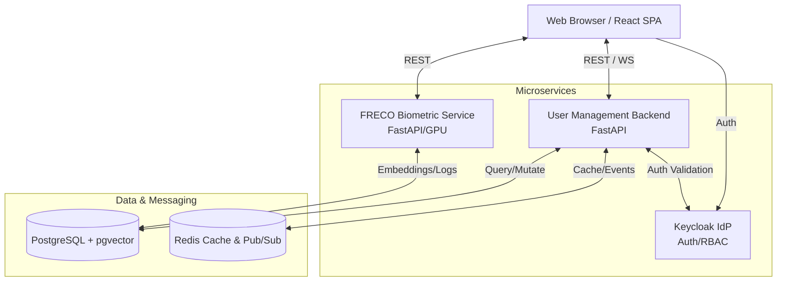
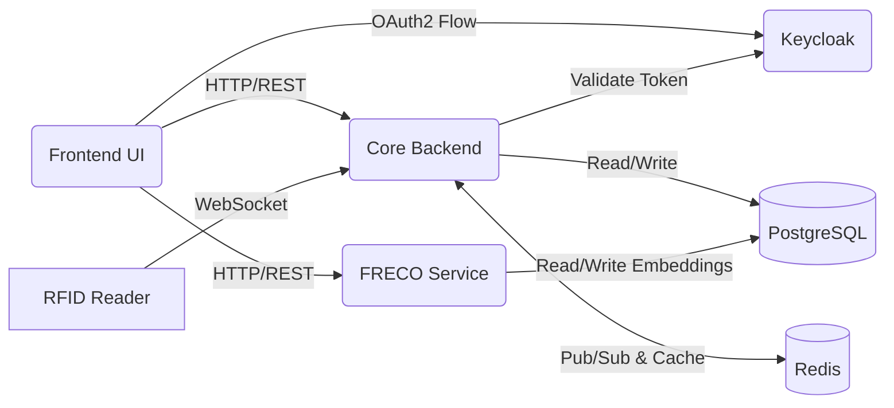
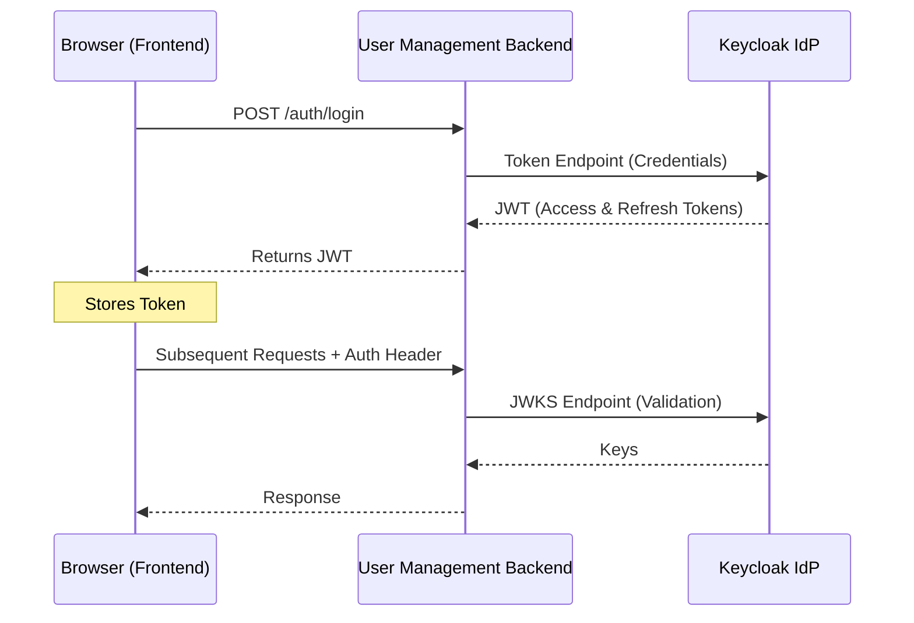
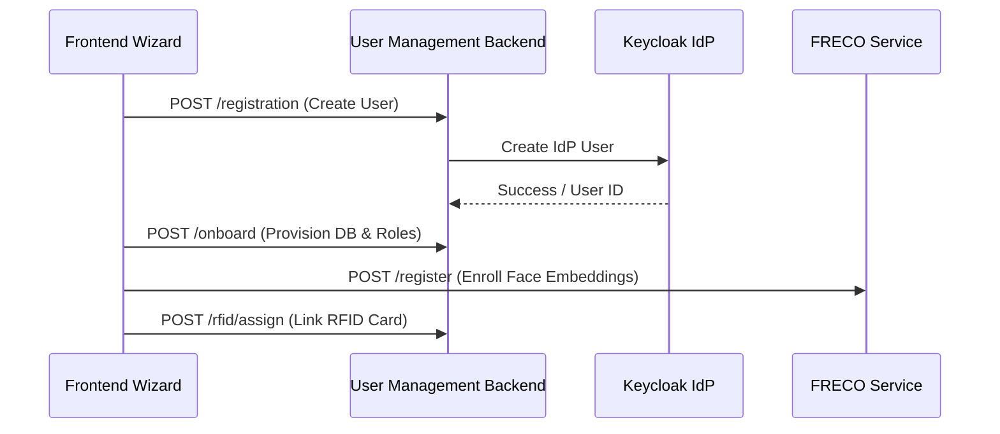
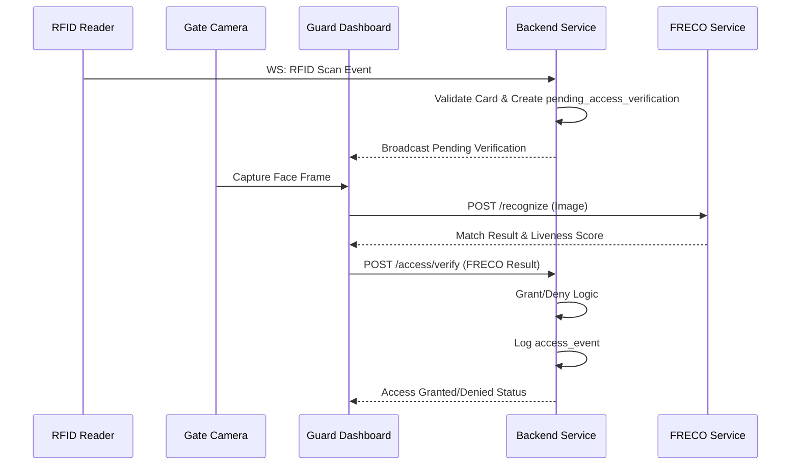
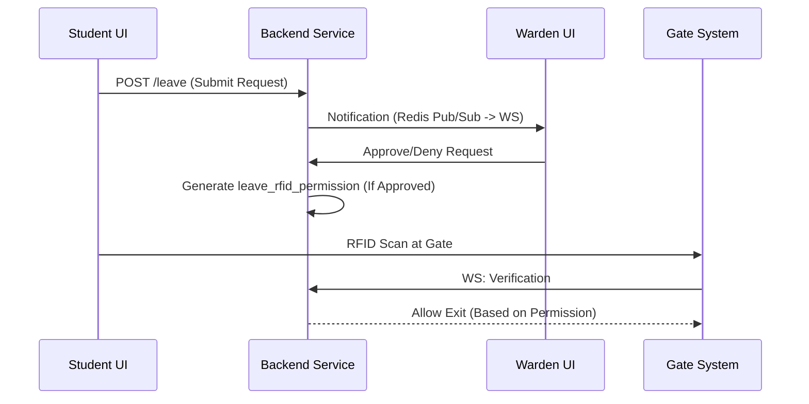

# OCOC Platform Architecture

Welcome to the OCOC (Our Campus, Our Community) platform architecture overview. This document serves as the master documentation entry point, providing a comprehensive view of the system's architecture, components, data flows, and security design.

## Table of Contents
1. [Platform Overview](#platform-overview)
2. [High-Level System Architecture](#high-level-system-architecture)
3. [System Components](#system-components)
4. [Component Interaction](#component-interaction)
5. [Data Flow Patterns](#data-flow-patterns)
6. [Security Architecture](#security-architecture)
7. [Deployment Topology](#deployment-topology)
8. [Tech Stack Summary](#tech-stack-summary)
9. [Documentation Index](#documentation-index)

## Platform Overview
OCOC is a comprehensive Campus Identity and Access Management (IAM) platform built using a microservices architecture. It manages student, faculty, and staff identities, physical campus access control (2-factor: RFID + Face Biometrics), hostel management, leave workflows, and provides real-time monitoring through role-based dashboards.

## High-Level System Architecture

## System Components

### 1. User Management Backend
- **Framework**: FastAPI, Python
- **Role**: Central API server handling all business logic (Auth, Users, Access Control, RFID, Hostel, Leave, Audit, Dashboard).
- **Integration**: PostgreSQL, Redis, Keycloak.

### 2. User Management Frontend
- **Framework**: React + Vite
- **Role**: Single Page Application (SPA) providing role-based dashboards (18 views, 20+ components).
- **Integration**: Connects to both the User Management Backend and FRECO services.

### 3. FRECO - Face Recognition Service
- **Framework**: FastAPI, Python (GPU-accelerated via NVIDIA CUDA)
- **Role**: Standalone biometric engine handling face detection (SCRFD), recognition (ArcFace), and liveness detection (MiniFASNet).
- **Integration**: PostgreSQL (pgvector for embedding storage), REST, and WebSocket APIs.

### 4. Keycloak (Identity Provider)
- **Role**: Centralized OAuth2/OIDC identity provider.
- **Configuration**: Realm `ococ`, Client `user-management`. Manages 13 distinct realm roles: `SUPER_ADMIN`, `ADMIN`, `USER_MANAGER`, `GUARD`, `WARDEN`, `SECURITY_ADMIN`, `VIEWER`, `STUDENT`, `FACULTY`, `SECURITY_GUARD`, `STAFF`, `WORKER`, `VISITOR`.
- **Integration**: Issues and validates JWT tokens.

### 5. Data Layer
- **PostgreSQL**: Shared database with `pgvector` extension for storing ~30+ tables and HNSW vector index for face embedding similarity search. Full-text search via `users_fts`.
- **Redis**: Used for OTP storage, rate limiting, caching, and WebSocket pub/sub for real-time events.

## Component Interaction

## Data Flow Patterns

### Authentication Flow

### User Registration & Onboarding Flow

### Gate Access Control (2-Factor: RFID + Face)

### Leave Workflow

## Security Architecture
The platform is designed with a defense-in-depth approach:
1. **Centralized Identity**: Keycloak acts as the central IdP handling OAuth2/OIDC flows.
2. **Token Validation**: API security via JWT token validation using JWKS endpoints.
3. **Role-Based Access Control (RBAC)**: Fine-grained access control with 13 Keycloak-provisioned roles plus 2 additional workflow roles, combined with local permission guards (see full breakdown below).
4. **Two-Factor Physical Auth**: Gate access requires both possession (RFID) and inherence (Face).
5. **Anti-Spoofing**: Built-in liveness detection (MiniFASNet) to prevent presentation attacks using photos or screens.
6. **Session Management**: Idle session timeouts (typically 15 minutes) enforced on the frontend.
7. **Auditability**: Immutable audit trails for critical actions.
8. **Resilience**: Redis-backed OTP for secure password recovery and rate limiting to prevent brute-force attacks.

### Complete Role Definitions

The platform defines **13 Keycloak realm roles** (provisioned by `setup_keycloak.py`) and **2 additional workflow roles** used only in backend permission guards for the leave approval chain.

#### 13 Keycloak-Provisioned Roles

| # | Role | Category | Description | Default Dashboard |
|---|------|----------|-------------|-------------------|
| 1 | `SUPER_ADMIN` | Administrative | God-mode. Unrestricted access to every module, endpoint, and action across the platform. | `/dashboard` |
| 2 | `ADMIN` | Administrative | Campus administrator. Manages access rules, device registry, user provisioning, and leave balances. Cannot access hostel or guard consoles directly. | `/access` |
| 3 | `USER_MANAGER` | Administrative | Delegated user management. Can create, read, update, import/export users and assign RFID cards, but cannot suspend/delete users or manage roles. | `/dashboard` |
| 4 | `SECURITY_ADMIN` | Security | Security operations manager. Oversees access rules, temporary grants, gate reviews, guard console, RFID operations, face auth logs, and audit trails. | `/guard` |
| 5 | `GUARD` | Security | Physical security guard at campus gates. Operates the guard console, processes RFID scans, performs manual gate reviews, and uses live face recognition. | `/guard` |
| 6 | `SECURITY_GUARD` | Security | Alias/variant of GUARD with identical permissions. Supports legacy or alternative naming in hardware integrations. | `/guard` |
| 7 | `WARDEN` | Hostel | Hostel warden. Manages hostel dashboard, student movements, permissions, emergency mode, and approves/denies student leave requests. | `/hostel` |
| 8 | `VIEWER` | Read-Only | Read-only analytics and audit viewer. Can view user directories, access occupancy data, analytics dashboards, and audit logs. Cannot modify any data. | `/analytics` |
| 9 | `STUDENT` | Campus User | Enrolled student. Can view personal dashboard, submit leave requests, and use digital gate passes. Profile stored in `student_profiles`. | `/dashboard` |
| 10 | `FACULTY` | Campus User | Teaching faculty member. Can view personal dashboard and profile. Profile stored in `faculty_profiles`. | `/dashboard` |
| 11 | `STAFF` | Campus User | Non-teaching staff member. Can view personal dashboard. Profile stored in `staff_profiles`. | `/dashboard` |
| 12 | `WORKER` | Campus User | Campus worker (maintenance, housekeeping, etc.). Can view personal dashboard. Profile stored in `worker_profiles`. | `/dashboard` |
| 13 | `VISITOR` | Campus User | Temporary campus visitor. Can view personal dashboard during visit duration. Profile stored in `visitor_profiles`. | `/dashboard` |

#### 2 Additional Workflow Roles (Backend Permission Guards Only)

These roles are referenced in the backend `PERM_TO_ROLES` permission map for the leave approval workflow but are **not provisioned by the default Keycloak setup script**. They must be manually created in Keycloak when the leave management module is deployed:

| # | Role | Category | Description |
|---|------|----------|-------------|
| 14 | `CHANCELLOR` | Workflow | Senior institutional authority. Approves leave requests escalated beyond warden level and can delegate leave approval authority. |
| 15 | `MEDICAL_OFFICER` | Workflow | Campus medical officer. Approves medical/sick leave requests and can delegate medical leave approval authority. |

#### Backend Permission-to-Role Mapping

The backend enforces granular permissions via `PERM_TO_ROLES` in [`security.py`](../user_management/backend/app/core/security.py). Each permission maps to one or more roles:

| Permission | Roles Allowed |
|------------|---------------|
| `user:create` | SUPER_ADMIN, ADMIN, USER_MANAGER |
| `user:read` | SUPER_ADMIN, ADMIN, USER_MANAGER, SECURITY_ADMIN, VIEWER |
| `user:update` | SUPER_ADMIN, ADMIN, USER_MANAGER |
| `user:suspend` | SUPER_ADMIN, ADMIN |
| `user:deactivate` | SUPER_ADMIN, ADMIN |
| `user:delete` | SUPER_ADMIN, ADMIN |
| `user:import` | SUPER_ADMIN, ADMIN, USER_MANAGER |
| `user:export` | SUPER_ADMIN, ADMIN, USER_MANAGER, VIEWER |
| `user:manage` | SUPER_ADMIN, ADMIN |
| `rfid:assign` | SUPER_ADMIN, ADMIN, USER_MANAGER, SECURITY_ADMIN |
| `rfid:replace` | SUPER_ADMIN, ADMIN, SECURITY_ADMIN |
| `rfid:revoke` | SUPER_ADMIN, ADMIN, SECURITY_ADMIN |
| `rfid:read` | SUPER_ADMIN, ADMIN, USER_MANAGER, SECURITY_ADMIN, VIEWER |
| `role:assign` | SUPER_ADMIN, ADMIN |
| `role:manage` | SUPER_ADMIN |
| `audit:read` | SUPER_ADMIN, ADMIN, SECURITY_ADMIN, VIEWER |
| `access.rule.read` | SUPER_ADMIN, ADMIN, SECURITY_ADMIN, VIEWER, GUARD, SECURITY_GUARD |
| `access.rule.manage` | SUPER_ADMIN, ADMIN, SECURITY_ADMIN |
| `access.grant.temporary` | SUPER_ADMIN, ADMIN, SECURITY_ADMIN |
| `access.grant.manage` | SUPER_ADMIN, ADMIN |
| `access.user.search` | SUPER_ADMIN, ADMIN, SECURITY_ADMIN |
| `access.user.detail` | SUPER_ADMIN, ADMIN, SECURITY_ADMIN |
| `access.audit.read` | SUPER_ADMIN, ADMIN, SECURITY_ADMIN |
| `access.occupancy.view` | SUPER_ADMIN, ADMIN, SECURITY_ADMIN, VIEWER |
| `gate.review.manual` | SUPER_ADMIN, ADMIN, SECURITY_ADMIN, GUARD, SECURITY_GUARD |
| `guard.console.read` | SUPER_ADMIN, ADMIN, SECURITY_ADMIN, GUARD, SECURITY_GUARD |
| `leave.request.submit` | SUPER_ADMIN, STUDENT |
| `leave.approve.warden` | SUPER_ADMIN, WARDEN |
| `leave.approve.chancellor` | SUPER_ADMIN, CHANCELLOR |
| `leave.approve.medical` | SUPER_ADMIN, MEDICAL_OFFICER |
| `leave.delegate` | SUPER_ADMIN, WARDEN, CHANCELLOR, MEDICAL_OFFICER |
| `leave.workflow.manage` | SUPER_ADMIN |
| `leave.balance.manage` | SUPER_ADMIN, ADMIN |
| `leave.audit.view` | SUPER_ADMIN, ADMIN, SECURITY_ADMIN |

#### Frontend Route Access Matrix

Defined in [`roleDashboard.js`](../user_management/frontend/src/utils/roleDashboard.js):

| Route | Roles With Access |
|-------|-------------------|
| `/dashboard` | SUPER_ADMIN, STUDENT, FACULTY, WORKER, VISITOR, USER, STAFF |
| `/users` | SUPER_ADMIN |
| `/onboarding` | SUPER_ADMIN |
| `/analytics` | SUPER_ADMIN, VIEWER |
| `/access` | SUPER_ADMIN, ADMIN |
| `/devices` | SUPER_ADMIN, ADMIN |
| `/guard` | SUPER_ADMIN, GUARD, SECURITY_GUARD, SECURITY_ADMIN |
| `/rfid` | SUPER_ADMIN, GUARD, SECURITY_GUARD, SECURITY_ADMIN |
| `/face-recognition` | SUPER_ADMIN, GUARD, SECURITY_GUARD, SECURITY_ADMIN |
| `/face-auth-log` | SUPER_ADMIN, GUARD, SECURITY_GUARD, SECURITY_ADMIN |
| `/hostel` | SUPER_ADMIN, WARDEN |
| `/leave` | SUPER_ADMIN, ADMIN, STUDENT, WARDEN, CHANCELLOR, MEDICAL_OFFICER, SECURITY_ADMIN, GUARD, SECURITY_GUARD |
| `/audit` | SUPER_ADMIN, SECURITY_ADMIN, VIEWER |

## Deployment Topology
- **Development**: Docker Compose is used for local development, providing a cohesive environment containing all services, databases, and caches.
- **Production (FRECO)**: Kubernetes manifests are provided for scalable deployment.
- **Hardware Acceleration**: The FRECO service requires the NVIDIA Container Toolkit and CUDA/cuDNN support for GPU-accelerated ML inference.
- **Infrastructure**: A shared PostgreSQL instance serves both the backend and FRECO, with Redis acting as the high-speed message broker and caching layer.

## Tech Stack Summary

| Component | Technology |
|---|---|
| **Backend Framework** | FastAPI (Python) |
| **Frontend Framework** | React + Vite |
| **Identity Provider** | Keycloak 26.7.3 |
| **Database** | PostgreSQL + pgvector |
| **Cache & Messaging** | Redis |
| **ML Inference** | ONNX Runtime (GPU), InsightFace |
| **Face Detection** | SCRFD (`scrfd_10g_bnkps.onnx`) |
| **Face Recognition** | ArcFace (`glintr100.onnx`) |
| **Anti-Spoofing** | MiniFASNet (V1SE + V2 ONNX) |
| **Containerization** | Docker, Docker Compose, Kubernetes |
| **GPU Support** | NVIDIA CUDA, cuDNN, NVIDIA Container Toolkit |
| **API Protocol** | REST + WebSocket |

## Documentation Index
For more detailed information, please refer to the specific component documentation:
- [USER_MANAGEMENT_BACKEND.md](./USER_MANAGEMENT_BACKEND.md) - Details on the FastAPI backend, routing, and services.
- [USER_MANAGEMENT_FRONTEND.md](./USER_MANAGEMENT_FRONTEND.md) - Details on the React SPA, dashboards, and UI structure.
- [FRECO.md](./FRECO.md) - Deep dive into the Face Recognition biometric engine and ML pipelines.
- [DATABASE_SCHEMA.md](./DATABASE_SCHEMA.md) - Comprehensive overview of the PostgreSQL schema and `pgvector` usage.
