# Campus IAM Database Schema Documentation

## Table of Contents
1. [Overview](#overview)
2. [Entity-Relationship Diagram](#entity-relationship-diagram)
3. [Schema Evolution & Migrations](#schema-evolution--migrations)
4. [Table Reference](#table-reference)
5. [Seed Data & Scripts](#seed-data--scripts)
6. [Related Documentation](#related-documentation)

## Overview
The OCOC microservices database is built on PostgreSQL with the `pgvector` extension for facial recognition embeddings. Through 21 migrations, it has evolved from a simple user directory to a full Campus Identity and Access Management (IAM) system, supporting access control, hardware integration, RBAC, and leave management.

## Entity-Relationship Diagram

```mermaid
erDiagram
    users ||--o| student_profiles : "has profile"
    users ||--o| faculty_profiles : "has profile"
    users ||--o| staff_profiles : "has profile"
    users ||--o| worker_profiles : "has profile"
    users ||--o| visitor_profiles : "has profile"
    users ||--o{ rfid_tags : "assigned"
    users ||--o| freco_people : "external_id"
    users ||--o{ access_events : "triggers"
    users ||--o{ leave_requests : "submits"
    users ||--o{ audit_logs : "actor/entity"
    users ||--o{ leave_balances : "has"
    users ||--o{ user_location_access : "granted"
    
    freco_people ||--o{ freco_face_embeddings : "has embeddings"
    
    departments ||--o{ student_profiles : "belongs to"
    departments ||--o{ faculty_profiles : "belongs to"
    
    hostels ||--o{ student_profiles : "resides in"
    hostels ||--o{ hostel_rooms : "contains"
    hostels ||--o{ warden_hostels : "managed by"
    users ||--o{ warden_hostels : "is warden of"
    
    hostel_rooms ||--o{ hostel_allocations : "allocated to"
    student_profiles ||--o{ hostel_allocations : "occupies"
    
    locations ||--o{ access_events : "occurs at"
    locations ||--o{ access_rules : "governs"
    locations ||--o{ rfid_readers : "contains"
    locations ||--o{ user_location_access : "grants access to"
    
    leave_requests ||--o{ leave_approvals : "receives"
    leave_requests ||--o{ leave_documents : "has"
    leave_types ||--o{ leave_requests : "categorized as"
    leave_types ||--o{ leave_balances : "tracked as"
```

## Schema Evolution & Migrations

### Initial & Directory Foundations
* **001_initial_schema.sql**: Baseline schema with `departments`, `hostels`, `users`, `rfid_tags`, a monolithic `user_profiles`, `audit_logs`, and `users_fts` (Full Text Search). Seeded with basic departments and hostels.
* **002_user_profiles_missing_columns.sql**: Expanded `user_profiles` with role-specific fields (school, contacts, visit details).

### Facial Recognition & Biometrics
* **003_face_auth_logs.sql**: Introduced `face_auth_logs` for authentication events and confidence scores.
* **004_pgvector_and_freco.sql**: Enabled `pgvector`. Created `freco_people` and `freco_face_embeddings` with HNSW vector indexes.

### Refactoring & Profile Splitting (MAJOR)
* **005_user_directory_indexes.sql**: Optimized querying with indexes on user type, active status, and department.
* **006_split_profiles.sql**: Major redesign migrating from a single `user_profiles` to specific tables: `student_profiles`, `faculty_profiles`, `staff_profiles`, `worker_profiles`, and `visitor_profiles`.
* **007_schema_refactoring.sql**: Added `school` to `departments`, dropped denormalized columns from split profiles, and enforced foreign keys for `freco_people` and `audit_logs`.

### Reference Data & Catalogs
* **008-010**: Backfilled directory filters, mapped schools in departments, and updated hostels (replaced generic BOYS/GIRLS with named hostels like Arvind, Paninni).

### Access Management & Hardware
* **011-017**: Introduced physical access control entities: `locations`, `access_events`, `temporary_access_grants`, `access_rules` (RBAC), `rfid_readers`, and `pending_access_verifications` (2FA gate flows). Added `hostel_rooms` and `hostel_allocations`.
* **018-020**: Hardened RBAC with `warden_hostels`, `user_location_access`, and expanded fields in `student_profiles` and `temporary_access_grants`.

### Leave Management (MAJOR)
* **021_leave_management.sql**: Comprehensive leave workflow system including `leave_types`, `leave_requests`, `leave_documents`, `leave_approvals`, `leave_delegations`, `leave_balances`, and related audit/notification structures.

## Table Reference

This is a comprehensive summary of all database tables.

### Core Identity
* **`users`**: Base identity (id, realm_id, keycloak_sub, email, username, user_type, is_active).
* **`users_fts`**: Full Text Search index for users.
* **`audit_logs`**: System-wide audit trail (entity, action, actor_id -> users.id, JSONB changes).

### Profiles (1:1 with Users)
* **`student_profiles`**: (user_id, full_name, enrollment_number, program, batch_year, department_id, hostel_id, room_number, blood_group, parent_name, parent_contact, nationality, gov_id_type).
* **`faculty_profiles`**: (user_id, full_name, employee_id, designation, department_id).
* **`staff_profiles`**, **`worker_profiles`**, **`visitor_profiles`**: Similarly structured based on role requirements.

### Biometrics & Hardware
* **`rfid_tags`**: (user_id, tag_uid, is_active, issued_at, revoked_at).
* **`rfid_readers`**: Physical readers mapped to locations.
* **`freco_people`**: (external_id -> users.id, name, created_at, updated_at).
* **`freco_face_embeddings`**: (person_id -> freco_people.id, face_id, embedding vector(512), quality_score, image_reference).
* **`face_auth_logs`**: (user_id, device_id, matched_at, confidence, status, image_reference).

### Organization & Infrastructure
* **`departments`**: (id, name, code, school).
* **`hostels`**: (id, name, code).
* **`hostel_rooms`**: (hostel_id, room_number, floor, capacity).
* **`hostel_allocations`**: (student_id, room_id, allocated_at).
* **`locations`**: (id, name, location_type, parent_id, requires_two_factor).

### Access Control
* **`access_events`**: Logs every entry/exit (timestamp, user, location, method).
* **`access_rules`**: RBAC definitions (role, location, time_from, time_to, action).
* **`temporary_access_grants`**: Guest passes, gate passes (expiry, access_level, status).
* **`pending_access_verifications`**: 2-factor gate flows (RFID + Face).
* **`user_location_access`**: Fine-grained grants (user_id, location_id).
* **`warden_hostels`**: Mapping wardens to hostels (M:N).

### Leave Management
* **`leave_types`**: (name, description, max_days, requires_approval, workflow JSONB).
* **`leave_requests`**: (user_id, leave_type_id, starts_at, ends_at, reason, status).
* **`leave_documents`**: (leave_request_id, file_path, file_type).
* **`leave_approvals`**: (leave_request_id, approver_id, decision, comments).
* **`leave_delegations`**: (delegator_id, delegate_id, valid_from, valid_to).
* **`leave_balances`**: (user_id, leave_type_id, academic_year, total_days, used_days).

## Seed Data & Scripts
1. **`setup_keycloak.py/sh`**: Initializes Keycloak `ococ` realm, `user-management` client, and provisions all 13 realm roles: `SUPER_ADMIN`, `ADMIN`, `USER_MANAGER`, `GUARD`, `WARDEN`, `SECURITY_ADMIN`, `VIEWER`, `STUDENT`, `FACULTY`, `SECURITY_GUARD`, `STAFF`, `WORKER`, `VISITOR`. Also creates an `admin_test` user with `SUPER_ADMIN` role. See [ARCHITECTURE.md — Complete Role Definitions](./ARCHITECTURE.md#complete-role-definitions) for role descriptions.
2. **`seed_demo_users.py`**: Generates realistic demo profiles across all roles.
3. **`seed_dummy_data.sql/py`**: Mass bulk import script (1.5MB) for load testing.
4. **`seed_rules.py`**: Seeds baseline physical access rules (e.g., Own Hostel Access, Campus Exit Restriction).

## Related Documentation
* [FRECO Documentation](FRECO.md)
* [User Management Backend](USER_MANAGEMENT_BACKEND.md)
