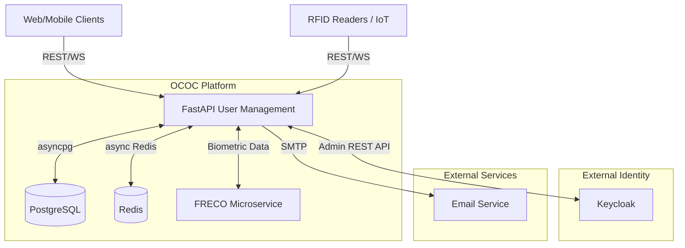
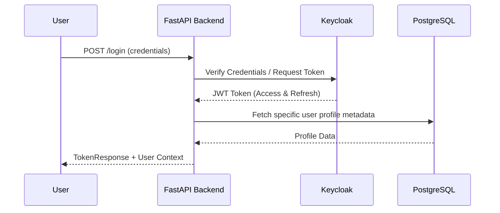
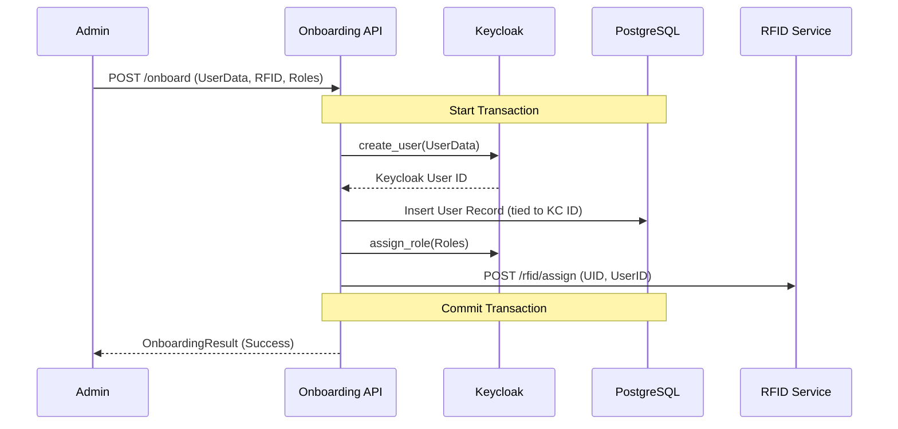
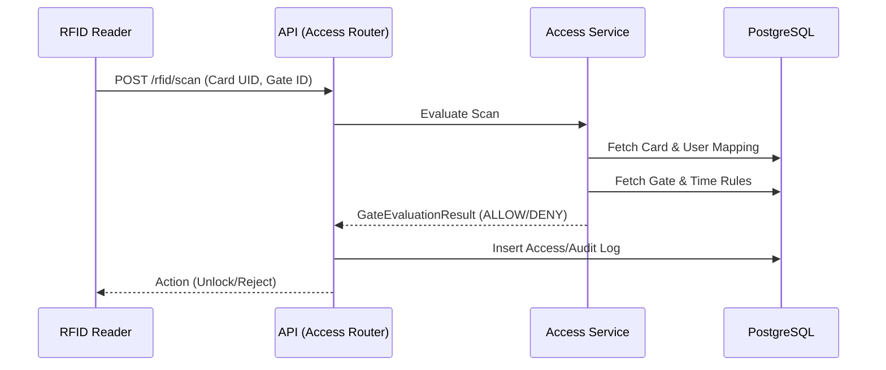
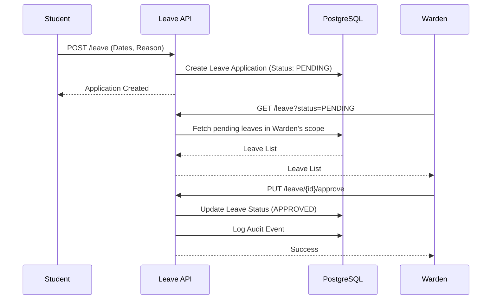

# User Management Backend Documentation

## Table of Contents
1. [What is User Management Backend](#what-is-user-management-backend)
2. [Architecture & Integrations](#architecture--integrations)
3. [Project Structure](#project-structure)
4. [Core Infrastructure](#core-infrastructure)
5. [Key Workflows (Sequence Diagrams)](#key-workflows)
6. [API Layer (Routers)](#api-layer-routers)
7. [Service Layer (Business Logic)](#service-layer-business-logic)
8. [Schemas (Data Models)](#schemas-data-models)
9. [External Integrations](#external-integrations)
10. [Environment Variables](#environment-variables)
11. [Deployment](#deployment)

---

## 1. What is User Management Backend

The **User Management Backend** is a high-performance FastAPI microservice acting as the central nervous system of the OCOC campus platform. It orchestrates user identity, authentication (via Keycloak), authorization (Role-Based Access Control - RBAC), physical access control (RFID and biometrics integration), hostel management, leave workflows, immutable audit trails, and real-time event streaming.

---

## 2. Architecture & Integrations

The service acts as the core hub connecting front-end applications, identity providers, databases, and external hardware systems.


*See also: [FRECO Microservice Documentation](FRECO.md), [Database Schema Documentation](DATABASE_SCHEMA.md)*

---

## 3. Project Structure

```text
user_management/backend/
├── app/
│   ├── main.py              # FastAPI app, CORS, lifespan, router registration
│   ├── config.py            # Pydantic Settings from .env
│   ├── core/
│   │   ├── database.py      # asyncpg connection pool
│   │   ├── keycloak_client.py # Keycloak Admin REST API wrapper
│   │   ├── redis_client.py  # Async Redis pool (OTP, caching, pub/sub)
│   │   └── security.py      # JWT validation, JWKS, role/permission guards
│   ├── routers/             # API endpoints (16 router modules)
│   ├── services/            # Business logic (12 service modules)
│   └── schemas/             # Pydantic models (12 schema modules)
├── migrations/              # 21 SQL migration files
├── Dockerfile
├── requirements.txt
└── .env
```

---

## 4. Core Infrastructure

### `database.py`
- Utilizes `asyncpg` for high-performance PostgreSQL connection pooling.
- Exposes `get_db` dependency for injecting connections into routers.
- Provides a Transaction context manager for executing atomic database operations.

### `keycloak_client.py`
- HTTP client wrapper (using `httpx`) around Keycloak's Admin REST API.
- Implements core identity functions: `create_user`, `update_user`, `assign_role`, and `reset_password`.
- Deeply integrated into `auth_service` and `registration_service`.

### `redis_client.py`
- Asynchronous Redis connection pooling.
- Used for short-lived state management: OTP storage, rate limiting, temporary tokens.
- Powers the WebSocket pub/sub mechanics for real-time event distribution.

### `security.py`
- Manages JWT validation leveraging `PyJWT` and JWKS fetched from Keycloak.
- Defines critical dependency injectors: `get_current_claims`, `require_role`, `require_permission`.
- Includes domain-specific access logic like `resolve_warden_hostel_scope`.

---

## 5. Key Workflows (Sequence Diagrams)

### 5.1 Authentication Flow


### 5.2 User Onboarding Flow


### 5.3 Access Control (RFID Gate Scan)


### 5.4 Leave Management Workflow


---

## 6. API Layer (Routers)

| Module | Purpose | Key Endpoints |
|---|---|---|
| `auth.py` | Authentication & Tokens | `POST /login`, `POST /token`, `POST /refresh`, `POST /otp` |
| `users.py` | User Management CRUD | `GET /users`, `GET /users/{id}`, `PUT /users/{id}` |
| `access.py` | Access Control validation | Rules management, Gate validation, Temporary access |
| `audit.py` | Audit Logging | `GET /audit` (Fetch immutable audit trails) |
| `dashboard.py`| Admin/Dashboard Metrics | `GET /dashboard/stats`, `GET /dashboard/trends` |
| `devices.py` | IoT Hardware | Register and poll IoT/RFID reader devices |
| `faceauth.py` | Biometric Logs | Log/validate face authentication results from FRECO |
| `hostel.py` | Hostel Management | Allocations, Room Management, Leave integration |
| `leave.py` | Leave Management | Student leave applications, Approval workflows (Warden/Admin) |
| `onboarding.py`| User Provisioning | `POST /onboard` (Atomic creation across Keycloak, DB, RFID) |
| `reference.py`| Lookup Data | Catalogs for departments, courses, ID types |
| `registration.py`| Sign-up Processing | Pre-Keycloak self/admin registration workflows |
| `reports.py` | Data Exports | CSV/PDF exports for attendance and audits |
| `rfid.py` | Physical Credentials | `POST /rfid/assign`, `POST /rfid/scan` |
| `roles.py` | RBAC Management | Query/assign Keycloak realm roles: SUPER_ADMIN, ADMIN, USER_MANAGER, GUARD, WARDEN, SECURITY_ADMIN, VIEWER, STUDENT, FACULTY, SECURITY_GUARD, STAFF, WORKER, VISITOR. See [ARCHITECTURE.md — Role Definitions](./ARCHITECTURE.md#complete-role-definitions) for full details. |
| `ws.py` | Real-time Streaming | RFID scan notifications, live dashboards via Redis Pub/Sub |

---

## 7. Service Layer (Business Logic)

- **`auth_service.py`**: Handles token issuance, communicates with Keycloak for password verification, and manages OTP lifecycles via Redis.
- **`user_service.py`**: Manages CRUD operations for user profiles, executing complex multi-table joins across core users, student profiles, faculty profiles, and departments.
- **`access_service.py`**: The core access control engine. Evaluates whether a user can pass a gate based on role rules, specific gate configurations, and temporal restrictions.
- **`audit_service.py`**: Ensures all critical system actions are written to immutable audit trails in the database.
- **`dashboard_service.py`**: Executes complex SQL aggregations (counts, temporal group bys) to power admin and warden dashboard views.
- **`faceauth_service.py`**: Processes biometric matching results against defined security thresholds and logs them.
- **`hostel_service.py`**: Orchestrates hostel allocations, gate access mappings, and specialized permission workflows.
- **`hostel_rfid_service.py`**: Bridging module connecting the logical hostel gate rules with physical RFID hardware scans.
- **`onboarding_service.py`**: Master orchestrator for provisioning. Ensures a Keycloak user record, PostgreSQL database profile, and physical RFID assignment happen atomically.
- **`registration_service.py`**: Handles data validation and pre-processing for new user sign-ups before they reach the Keycloak identity phase.
- **`rfid_service.py`**: Manages the lifecycle of RFID cards, including UID validation, revocation status checks, and raw hardware scan processing.
- **`role_service.py`**: Synchronizes local PostgreSQL role mappings and metadata with the master roles defined in Keycloak.

---

## 8. Schemas (Data Models)

The Pydantic schemas enforce strict data validation at the API boundaries:

- **`auth.py`**: `LoginRequest`, `TokenResponse`, `OTPRequest`
- **`user.py`**: `User`, `UserCreate`, `UserUpdate`, `StudentProfile`, `FacultyProfile`
- **`access.py`**: `AccessRule`, `AccessLog`, `GateEvaluationResult`
- **`audit.py`**: `AuditLog`, `AuditQuery`
- **`common.py`**: `PaginatedResponse`, `HTTPError`
- **`dashboard.py`**: `DashboardStats`, `TrendPoint`, `Analytics`
- **`faceauth.py`**: `LogRequest`, `LogEntry`, `FaceAuthListResult`
- **`hostel.py`**: `HostelGate`, `CreatePermissionRequest`, `RFIDScanRequest`, `StudentHostelStatus`
- **`onboarding.py`**: `OnboardingRequest`, `OnboardingResult`
- **`registration.py`**: `RegistrationRequest`, `RegisteredUser`
- **`rfid.py`**: `Card`, `AssignRequest`, `ScanResult`
- **`role.py`**: `Role`, `CreateRoleRequest`, `AssignRoleRequest`

---

## 9. External Integrations

1. **Keycloak**: Primary Identity Provider (IdP) for generating JWTs, user authentication, and defining baseline RBAC roles.
2. **PostgreSQL (asyncpg)**: Source of truth for all application state, structured relationships, and audit logs. (Uses `pgvector` for advanced capabilities if needed).
3. **Redis**: In-memory data structure store used for API caching, WebSocket pub/sub message brokering, and transient OTP state.
4. **SMTP Server**: Handles dispatching Email OTPs and notification emails.
5. **RFID Hardware Readers**: Integrated directly via WebSockets/REST to capture physical card scans at campus gates.
6. **FRECO Microservice**: External biometric engine for processing and verifying face authentication logs.

---

## 10. Environment Variables

Essential variables required to run the service:
- `POSTGRES_URL`: Connection string for asyncpg (e.g., `postgresql+asyncpg://...`)
- `REDIS_URL`: Connection string for Redis.
- `KEYCLOAK_URL`, `KEYCLOAK_REALM`, `KEYCLOAK_CLIENT_ID`, `KEYCLOAK_CLIENT_SECRET`: Configuration for Keycloak Admin integration.
- `SMTP_*`: Settings for email delivery.

---

## 11. Deployment

- **Containerization**: Packaged via `Dockerfile` using `python:3.11-slim`, exposing port `8080`.
- **Orchestration**: Managed via `docker-compose.yml`, which bundles:
  - `postgres` (with `pgvector` extensions)
  - `redis`
  - `keycloak`
  - `backend` (this service)
  - `frontend`
