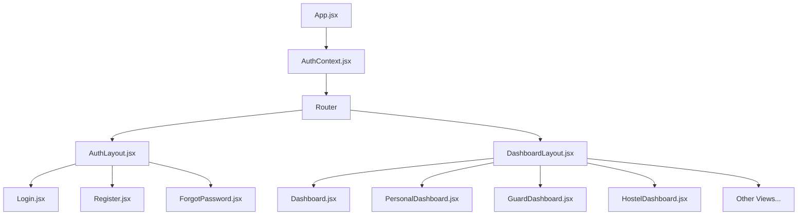
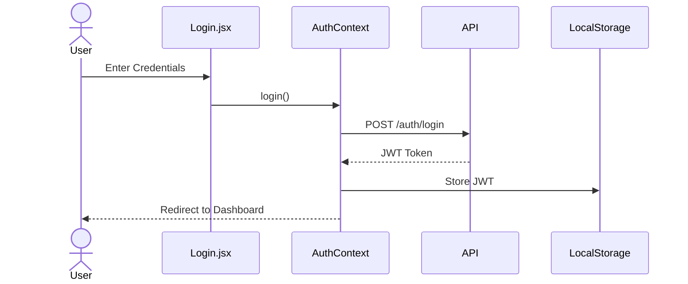
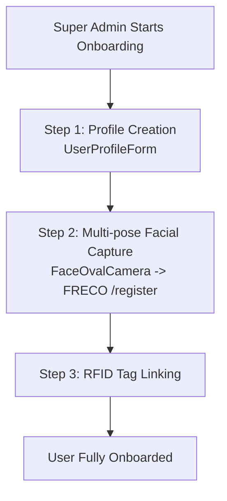

# User Management Frontend

A React + Vite single-page application providing the complete UI for the OCOC campus management platform. It implements strict Role-Based Access Control (RBAC) with different dashboards and capabilities per user role.

## Table of Contents
1. [Tech Stack](#tech-stack)
2. [Project Structure](#project-structure)
3. [Component Architecture](#component-architecture)
4. [Role-Based Access Control (RBAC)](#role-based-access-control-rbac)
5. [Key User Flows](#key-user-flows)
6. [Views & Components Reference](#views--components-reference)
7. [Services Layer](#services-layer)
8. [Security Features](#security-features)
9. [Cross-References](#cross-references)

## Tech Stack
- **React 18+** with JSX
- **Vite** as build tool
- **React Router** for navigation
- **Axios** for HTTP client
- **react-chartjs-2** for charts/analytics
- **Tailwind CSS** / custom CSS for styling

## Project Structure
```text
user_management/frontend/src/
├── main.jsx                 # React DOM render entry
├── App.jsx                  # Router + AuthContext provider
├── context/
│   └── AuthContext.jsx      # Global auth state (JWT, user, roles)
├── layouts/
│   ├── AuthLayout.jsx       # Wrapper for login/register screens
│   └── DashboardLayout.jsx  # Main shell with nav, header, idle timeout
├── views/                   # Page-level components (18 views)
├── components/              # Reusable UI components
├── services/                # API abstraction layer
├── hooks/
│   └── useLiveFaceInference.js  # Webcam + FRECO streaming hook
└── utils/
    ├── date.js              # Date formatting utilities
    └── roleDashboard.js     # RBAC routing rules
```

## Component Architecture



## Role-Based Access Control (RBAC)

RBAC is strictly enforced via [`roleDashboard.js`](../user_management/frontend/src/utils/roleDashboard.js). The `ROUTE_PERMISSIONS` map and `isAuthorizedForRoute()` function gate every navigation. The platform uses **13 Keycloak-provisioned roles** and **2 additional workflow roles** (see [ARCHITECTURE.md — Complete Role Definitions](./ARCHITECTURE.md#complete-role-definitions) for backend permission details).

| # | Role | Category | Accessible Routes | Default Redirect |
|---|------|----------|-------------------|------------------|
| 1 | `SUPER_ADMIN` | Admin | **All routes** — unrestricted full access | `/dashboard` |
| 2 | `ADMIN` | Admin | `/access`, `/devices`, `/leave` | `/access` |
| 3 | `USER_MANAGER` | Admin | `/dashboard` (inherits base access) | `/dashboard` |
| 4 | `SECURITY_ADMIN` | Security | `/guard`, `/rfid`, `/face-recognition`, `/face-auth-log`, `/leave`, `/audit` | `/guard` |
| 5 | `GUARD` | Security | `/guard`, `/rfid`, `/face-recognition`, `/face-auth-log`, `/leave` | `/guard` |
| 6 | `SECURITY_GUARD` | Security | `/guard`, `/rfid`, `/face-recognition`, `/face-auth-log`, `/leave` | `/guard` |
| 7 | `WARDEN` | Hostel | `/hostel`, `/leave` | `/hostel` |
| 8 | `VIEWER` | Read-Only | `/analytics`, `/audit` | `/analytics` |
| 9 | `STUDENT` | Campus User | `/dashboard` (PersonalDashboard), `/leave` | `/dashboard` |
| 10 | `FACULTY` | Campus User | `/dashboard` (PersonalDashboard) | `/dashboard` |
| 11 | `STAFF` | Campus User | `/dashboard` (PersonalDashboard) | `/dashboard` |
| 12 | `WORKER` | Campus User | `/dashboard` (PersonalDashboard) | `/dashboard` |
| 13 | `VISITOR` | Campus User | `/dashboard` (PersonalDashboard) | `/dashboard` |
| 14 | `CHANCELLOR` | Workflow | `/leave` (approval authority) | — |
| 15 | `MEDICAL_OFFICER` | Workflow | `/leave` (medical leave approval) | — |

## Key User Flows

### Authentication Flow


### Onboarding Flow (Super Admin)


### Face Recognition Flow
1. `FaceRecognition.jsx` -> `FaceOvalCamera` / `FaceWideCamera`
2. `useLiveFaceInference.js` captures webcam frames
3. Frames sent to FRECO `/stream` WebSocket OR `/recognize` REST
4. Results displayed in real-time

### Hostel Dashboard Flow (Warden)
1. `HostelDashboard.jsx` -> `HostelStatsCards` (real-time counts)
2. `LiveStatusTable` (who's in/out)
3. `MovementHistoryTable` (entry/exit log)
4. `PermissionPanel` (approve/deny permissions)
5. `EmergencyMode` (lockdown capabilities)

## Views & Components Reference

### Key Views
- **Dashboard.jsx:** Super Admin overview
- **PersonalDashboard.jsx:** Standard user workspace
- **GuardDashboard.jsx:** Security interface
- **HostelDashboard.jsx:** Warden real-time stats
- **Onboarding.jsx:** Multi-step provisioning wizard
- **FaceRecognition.jsx:** Live biometric scanning
- **AccessManagement.jsx:** Rule-based access control
- **LeaveManagement.jsx:** Leave approval workflow

### Key Components
- **FaceOvalCamera.jsx / FaceWideCamera.jsx:** Specialized UI for face capture
- **UserProfileForm.jsx / EditUserModal.jsx:** Forms for user data
- **DigitalGatePassModal.jsx:** UI for approved leave passes
- **Hostel / Access Panels:** Specific domain components for wardens and admins.

## Services Layer
The API layer abstracts HTTP requests:
- **api.js:** Creates base Axios instance with Authorization header interceptor.
- **frecoService.js:** INDEPENDENT Axios instance pointing to FRECO microservice URL.
- **userService.js, accessService.js, etc:** Use the base `api.js` instance for standardized backend communication.

## Security Features
- **Idle Session Warning:** 15-minute inactivity -> auto-logout handled in `DashboardLayout.jsx`.
- **JWT Interceptors:** Automatically attach tokens to all secured API calls.
- **Role-based Route Guards:** Ensure users can only access permitted views.
- **Legal Compliance:** `LegalModal` for terms and policies acceptance.

## Cross-References
- [FRECO Microservice Documentation](FRECO.md)
- [User Management Backend Documentation](USER_MANAGEMENT_BACKEND.md)
